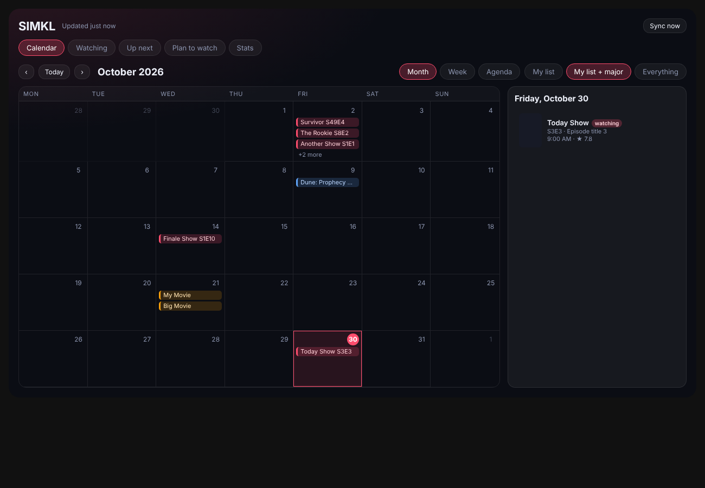
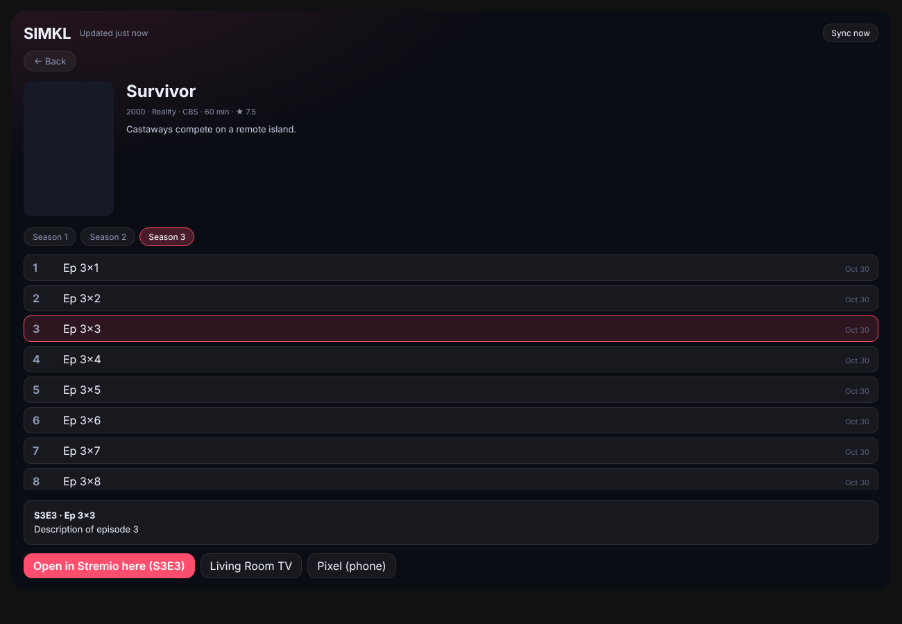

# SIMKL Hub for Home Assistant

Your [SIMKL](https://simkl.com) lists inside Home Assistant, with a **release calendar**, show/episode pages and
**open in Stremio** on Android TV / Google TV / Nvidia Shield or your phone.


*Sample data. Month, week and agenda views; click a day to see everything releasing.*

## Features

- **Calendar** (Month / Week / Agenda) of upcoming episodes, premieres and movie releases, fed by SIMKL's public calendar files.
  Filter: *My list*, *My list + major* (most-followed titles) or *Everything*. Click a day for the full list.
- **Watching, Up next, Plan to watch, Stats** from your own account. *Up next* is ordered by what you watched most recently.
- **Show pages**: description, seasons, episodes, episode descriptions. Opens on your next unwatched episode.
- **Open in Stremio** on the device you are using, or send it to any Android TV / Google TV (Android TV Remote or ADB integration) or to a phone running the Home Assistant Companion app.
- A **sidebar panel** ("SIMKL") that works straight after setup, plus a `calendar.simkl_*_my_releases` entity and count sensors for automations.
- Sign-in uses SIMKL's PIN flow. **No password is typed into Home Assistant.** Tokens are stored in the config entry and refreshed automatically.



## Install

1. HACS → Integrations → ⋮ → **Custom repositories** → add `https://github.com/tandarra/SIMKL-HomeAssistant` as *Integration*, then install **SIMKL Hub** and restart Home Assistant.
2. Create your own free SIMKL app (needed because SIMKL rate-limits per app): <https://simkl.com/settings/developer/> → *New app*. Pick the PIN / device sign-in type and copy the **Client ID**.
3. Home Assistant → Settings → Devices & services → **Add integration → SIMKL Hub**. Paste the Client ID, then open the link shown, enter the code on simkl.com and approve it while signed in to your account.
4. Open **SIMKL** in the sidebar, or add the card to a dashboard:

```yaml
type: custom:simkl-hub-card
default_tab: calendar        # calendar | watching | upnext | plan | stats
players:                     # optional; otherwise Android TV and phone targets are discovered
  - name: Living room
    entity: remote.living_room_tv
  - name: Lounge
    entity: remote.lounge_tv
```

The card is loaded automatically; no resource needs to be added.

## Open in Stremio: how it works

| Target | How |
| --- | --- |
| **This device** | Opens a `stremio://` link in the browser/app you are using (phones and tablets with Stremio). |
| `remote.*` (Android TV Remote integration) | `remote.turn_on` with the link as the activity. |
| `media_player.*` (Android Debug Bridge integration) | `androidtv.adb_command` runs `am start -a android.intent.action.VIEW -d <link>`. |
| `media_player.*` (other) | `media_player.play_media` with type `url`. |
| `notify.mobile_app_*` | Sends a notification; tapping it opens the link on the phone. |

It is also a service you can use in automations:

```yaml
action: simkl_hub.open_in_stremio
data:
  target: remote.living_room_tv
  kind: show        # show | anime | movie
  imdb: tt0239195
  season: 3
  episode: 3
```

Links look like `stremio:///detail/series/<imdb>/<imdb>:<season>:<episode>`; without an IMDb ID it falls back to a Stremio search.
Stremio opens the title page for that episode, so you pick the stream from there.

## Entities

- `sensor.simkl_<name>_watching`, `_plan_to_watch`, `_episodes_waiting`
- `calendar.simkl_<name>_my_releases` (your own list only), usable in the regular Calendar panel and in automations.

## Options

Settings → Devices & services → SIMKL Hub → Configure: how many popular TV/anime titles and movies to add to the
"major" calendar filter per month, and the sync interval (default 20 min).

## Notes on SIMKL limits

The free tier allows about 500 requests per day per user. The integration first asks SIMKL what changed (one request) and only
re-downloads your lists when something did. Calendar data comes from SIMKL's public CDN files and costs no user quota.

## Privacy

Everything runs inside your Home Assistant. Requests go only to `api.simkl.com`, `data.simkl.in` and (for posters) `simkl.in`.

## Development

```
pip install pytest-homeassistant-custom-component home-assistant-frontend
pytest
```

Not affiliated with SIMKL or Stremio.
